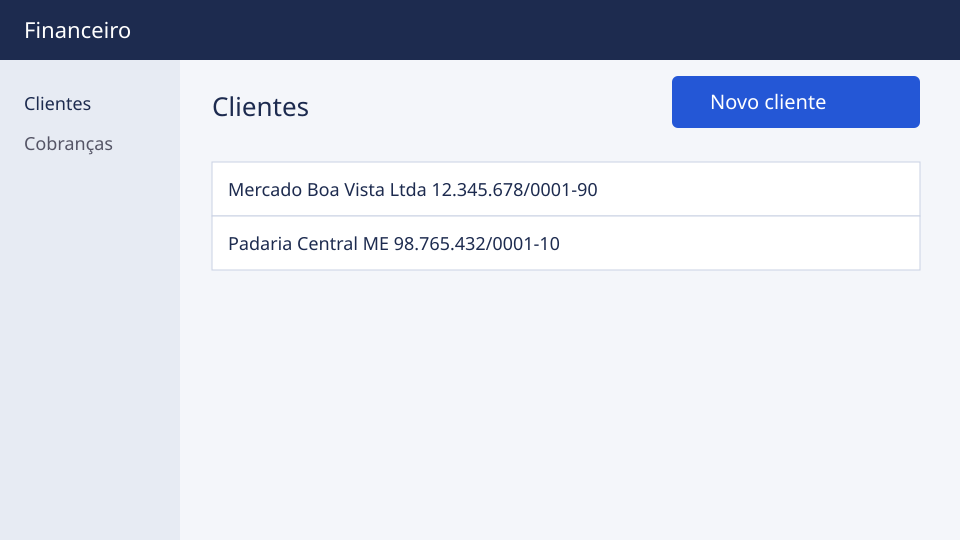

Só o administrador emite cobranças.

1. Abra o cliente na lista.

   > Resultado: aparecem os dados e as cobranças do cliente.

2. Clique em **Nova cobrança** e informe o valor.

   > Resultado: a cobrança fica como pendente.

